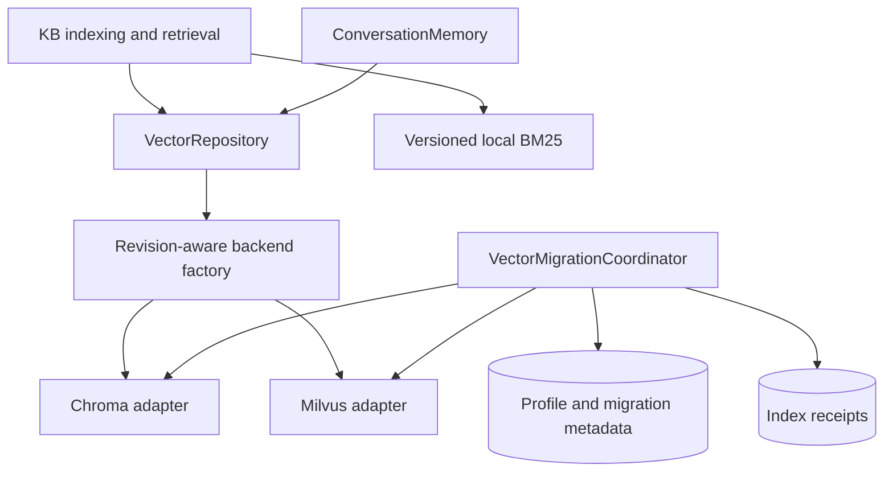
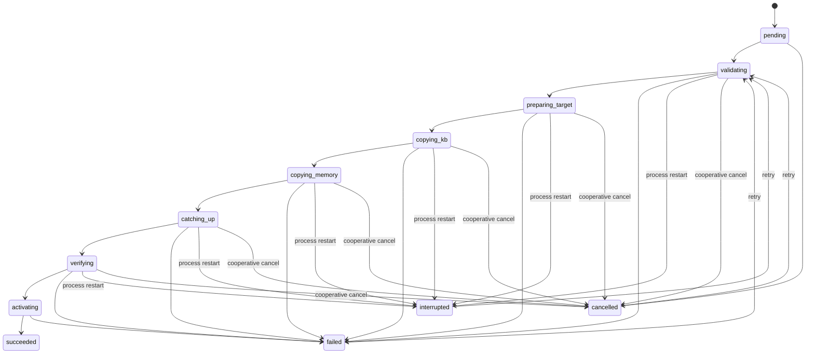

# Milvus Vector Database Integration and Migration Design

**Date**: 2026-08-09
**Status**: Approved for implementation

## 1. Summary

Porto will support versioned vector database profiles backed by either local Chroma or a remote Milvus database. Knowledge Base (KB) and conversation Memory will use a shared Porto-owned storage contract rather than directly depending on Chroma APIs.

Saving a new vector database profile does not immediately replace the active store. The backend validates and records it as pending, and the frontend asks whether to migrate now or later. The old store remains active until KB and Memory have both been copied, caught up, and verified. Activation is an atomic local metadata change. Failed or interrupted migrations leave the old store serving traffic and can be retried.

The same workflow supports Chroma to Milvus, Milvus to Chroma, and Milvus to Milvus migrations.

## 2. Goals

- Configure and persist Chroma and remote Milvus profiles from the Porto frontend and backend.
- Keep one active vector database profile and, when needed, one pending profile.
- Store both KB vectors and Memory vectors in the active profile.
- Prompt for immediate or deferred migration after saving a profile that changes storage identity.
- Keep chat and retrieval available on the old store during the bulk migration.
- Migrate KB and Memory as one activation unit.
- Catch up records written during migration before activation.
- Verify the destination before activation and preserve the old profile on failure.
- Support restart-safe progress, retries, cancellation, and observable status.
- Preserve current Chroma behavior for existing installations without forcing a migration.

## 3. Non-goals

- Provisioning or operating a Milvus server.
- Supporting vector databases other than Chroma and Milvus in this release.
- Continuous multi-primary replication after a migration succeeds.
- Making Milvus the canonical store for conversation message text. SQLite remains canonical.
- Changing the configured embedding provider as part of a pure vector database migration.
- Automatically deleting source or failed destination collections.
- Encrypting all existing Porto configuration secrets at rest. This design preserves the current local SQLite security boundary while making vector credentials write-only over the API and fully redacted from logs.

## 4. Current State and Constraints

### 4.1 KB storage

`backend/src/porto_chatbot/vector_store.py` contains a Chroma-specific `ChromaVectorStore`. It owns document discovery, splitting, embedding, collection lifecycle, vector search, BM25 integration, compatibility metadata, and index statistics. `LocalVectorStore` is only a compatibility alias.

`backend/src/porto_chatbot/retrieval.py` also depends on the LlamaIndex Chroma adapter for vector and hybrid retrieval. BM25 records use Chroma IDs and fetch matched text back from Chroma.

### 4.2 Memory storage

`backend/src/porto_chatbot/memory/conversation_memory.py` constructs a separate Chroma client directly. It indexes complete messages and performs a `session_id` metadata filter. The authoritative sessions and messages remain in `memory.sqlite3` through `SessionStore`.

The existing `messages.indexed` boolean only describes the current single-store world. It cannot identify which profile contains a record and therefore cannot be used as the migration receipt.

### 4.3 Runtime lifecycle

`backend/src/porto_chatbot/api/deps.py` caches `ConversationMemory` by `data_dir`, not by storage configuration. Saving a new storage profile without revision-aware invalidation would leave a live process connected to the previous backend.

`IndexSupervisor` already provides a useful single-worker pattern and persistent status, but only for KB rebuilds. Vector database migration requires an independent coordinator and lock because it spans KB, Memory, profiles, and activation.

### 4.4 Settings and frontend

Application settings are persisted as namespaces in `settings.sqlite3`. The settings API currently has no profile revision, pending configuration, validation result, or migration state. The frontend saves RAG settings directly from `porto-workbench.tsx` and has no post-save migration decision.

## 5. Decision Summary

| Concern | Decision |
|---|---|
| Backend abstraction | Porto-owned `VectorRepository` contract with Chroma and Milvus adapters |
| Migration architecture | Persistent staged migration coordinator |
| Activation | Old profile remains active until one atomic local pointer switch |
| Scope | KB and Memory migrate as one activation unit |
| Writes during migration | Old store remains writable; bulk copy is followed by catch-up and a short finalization barrier |
| Backend combinations | Chroma to Milvus, Milvus to Chroma, and Milvus to Milvus |
| Vector handling | Copy existing vectors when the embedding fingerprint and distance metric match |
| BM25 | Remains local and is versioned with the target KB generation |
| Memory text | SQLite remains canonical; vector hits are hydrated by message ID |
| Milvus SDK | Direct `pymilvus` `MilvusClient`, without a second LlamaIndex Milvus lifecycle layer |
| Milvus index | HNSW; inherit the source metric for migrations, default to COSINE for new empty stores |
| Failed targets | Retained for retry or explicit user-confirmed cleanup |

## 6. Architecture



### 6.1 Storage contract

The backend-neutral contract deals only with vector records and collection capabilities. KB splitting, embedding, reranking, BM25 fusion, and message hydration remain Porto application behavior.

```python
@dataclass(frozen=True)
class VectorRecord:
    id: str
    embedding: list[float]
    document: str | None
    metadata: dict[str, object]


class VectorRepository(Protocol):
    def ensure_collection(self, spec: CollectionSpec) -> None: ...
    def collection_info(self, name: str) -> CollectionInfo: ...
    def upsert(self, name: str, records: Sequence[VectorRecord]) -> int: ...
    def search(self, request: VectorSearchRequest) -> list[VectorSearchHit]: ...
    def fetch(self, name: str, ids: Sequence[str]) -> list[VectorRecord]: ...
    def export_batches(self, name: str, batch_size: int) -> Iterator[list[VectorRecord]]: ...
    def count(self, name: str) -> int: ...
    def delete(self, name: str, ids: Sequence[str]) -> int: ...
    def health(self) -> VectorStoreHealth: ...
    def close(self) -> None: ...
```

The contract must have one shared behavioral test suite. Backend-specific options are carried by `CollectionSpec` and profile configuration, not exposed to KB or Memory call sites. Adapters translate backend exceptions into typed Porto errors, including `DimensionMismatchError`, `CollectionNotReadyError`, and `VectorStoreConnectionError`; callers must not inspect provider-specific exception strings.

`VectorRecord.metadata` has one canonical, round-trip-safe representation. KB records preserve `path`, `title`, `root`, `chunk` as an integer, `source_mtime` as a float, and all splitter metadata without type coercion. Memory records preserve `session_id`, `role`, `intent`, `created_at`, and `message_id`. Adapter contract tests export every record after an upsert and assert exact IDs, documents, vectors, metadata keys, and scalar types.

`export_batches` is a snapshot-bounded, primary-key-ascending stable traversal, not offset pagination over a changing collection. Records inserted after the captured snapshot are excluded and handled by catch-up. Contract tests insert records during export and assert that every record in the captured snapshot appears exactly once.

### 6.2 Revision-aware factory

Every active-profile lookup includes the local `vector_store_state.revision`. Runtime clients are cached by `(data_dir, profile_id, revision)`. A successful activation increments the revision, closes stale clients, and causes the next request to construct the destination adapter. No request may resolve the pending profile for normal reads or writes.

### 6.3 Physical collection isolation

Physical collection names include both profile revision and, for KB, generation:

| State | KB physical name | Memory physical name |
|---|---|---|
| Legacy before Plan 1 | `porto_kb` | `porto_memory` |
| Plan 1 before profiles | `porto_kb__g7` | `porto_memory` |
| Plan 2+ profile revision 4 | `porto_kb__r4_g7` | `porto_memory__r4` |

Generation state stores the resolved physical name instead of deriving it later. Existing Chroma installations register the actual active physical name during compatibility bootstrap. Migration and rebuild never clear or overwrite an active physical collection.

### 6.4 Distance and score semantics

Distance metric is a profile property, collection metadata, and part of the embedding/storage compatibility fingerprint. Existing Chroma collections bootstrap as `L2` because that is Chroma's current default. A migration resolves the profile metric from either non-empty source domain and requires both non-empty domains to agree. Only when both domains are empty does it default to COSINE. The destination uses that metric: Milvus therefore uses HNSW+L2 for an existing L2 Chroma source and HNSW+COSINE for a COSINE source.

Every adapter returns a higher-is-better normalized score:

- L2 distance: `exp(-distance)`, matching Porto's current KB behavior. Memory currently uses another monotonic transform; Plan 1 standardizes it without changing result ordering.
- COSINE similarity: clamp the backend similarity to `[-1, 1]` and map it to `[0, 1]` with `(similarity + 1) / 2`.

Raw backend distances never leave the adapter. This preserves ranking across a pure storage migration and gives reranking and hybrid fusion one documented score contract. Changing the metric is not a storage migration; it requires an explicit rebuild/re-embedding operation.

## 7. Persistent Data Model

The following tables live in Porto's local settings database because they coordinate application configuration and activation across backends.

### 7.1 `vector_store_profiles`

| Column | Meaning |
|---|---|
| `id` | Stable UUID primary key |
| `name` | User-visible unique profile name |
| `backend` | `chroma` or `milvus` |
| `uri` | Chroma path identity or remote Milvus URI |
| `database_name` | Milvus database; null for Chroma |
| `kb_collection` | Physical KB collection name |
| `memory_collection` | Physical Memory collection name |
| `auth_mode` | `none`, `token`, or `user_password` |
| `username` | Optional username |
| `credential` | Optional locally stored secret; never returned by API |
| `tls_enabled` | Whether TLS is required |
| `timeout_seconds` | Request timeout, minimum 1 second |
| `config_fingerprint` | Hash of storage identity fields excluding the secret value |
| `created_at`, `updated_at` | UTC timestamps |

Updating a profile while preserving an existing credential requires an explicit `credential_configured` state. An omitted credential preserves the stored value; an explicit clear operation removes it.

### 7.2 `vector_store_state`

This singleton row contains `active_profile_id`, optional `pending_profile_id`, monotonically increasing `revision`, and `updated_at`.

The invariant is: only `active_profile_id` is used for production vector reads and writes.

### 7.3 `vector_migrations`

The migration record contains source and target profile IDs, status, phase, per-domain totals and copied counts, source watermarks, heartbeat, error, timestamps, and verification summary. Only one migration may be `running` for a Porto data directory.

### 7.4 KB generations and BM25 generations

KB generation is an explicit monotonically increasing integer stored per profile in the settings database together with resolved vector collection and BM25 paths. `IndexSupervisor` allocates a new generation, builds a new physical vector collection and `bm25s_index/g<generation>` directory, verifies both, and only then atomically switches that profile's active KB and BM25 generation pointers. A failed build never clears the active collection.

`Bm25Registry` caches by `(data_dir, profile_id, generation)`. Activation changes only pointers to already complete vector and BM25 generations; it never renames or moves files inside the activation transaction. Compatibility bootstrap registers the existing collection and existing `bm25s_index` as generation 1.

A vector migration captures the source KB generation before copying. If that pointer changes during copy, the inactive destination KB generation is rebuilt from the new source generation. The coordinator retries this at most twice; a third concurrent KB change fails the migration with `kb_generation_unstable` and leaves the source active.

### 7.5 Memory index intents and receipts

Memory delivery state lives in `memory.sqlite3`, beside `messages`, so intent creation and message persistence can share a SQLite transaction.

`vector_index_intents` contains an auto-incrementing `seq`, unique `record_id`, and `created_at`. An intent is created only when the current chat path requests vector indexing. DIRECT/chitchat paths that intentionally pass `index_vector=False` create no intent and must never be introduced by migration.

`vector_index_receipts` contains `record_id`, `profile_id`, and `indexed_at`, with primary key `(record_id, profile_id)`. A receipt is written only after that profile successfully stores the vector. The existing `messages.indexed` boolean is retained during compatibility migration but becomes a derived compatibility field.

The Memory migration watermark is the maximum intent `seq`, never UUID order or an unindexed timestamp. Existing installations bootstrap source-profile receipts only for IDs exported from the source Memory collection. This makes the source profile's actual indexed set authoritative even when a historical vector write failed.

KB migration progress uses generation plus deterministic batch cursor and does not create one SQLite receipt per chunk.

## 8. Milvus Profile and Collection Design

`MilvusClient` supports URI, token or username/password, database name, and timeout. Porto exposes those settings and performs a connection test before accepting a profile as a usable pending target.

### 8.1 KB collection

- `id`: `VARCHAR`, primary key, no auto ID.
- `embedding`: `FLOAT_VECTOR`, dimension from the active embedding fingerprint.
- `content`: `VARCHAR`, with a 32,000-byte limit for Porto's maximum 8,000 Unicode-character chunk; save validation rejects a configured chunk limit that can exceed Milvus' 65,535-byte field ceiling.
- `path`, `title`, and `root`: scalar `VARCHAR` fields.
- `metadata`: `JSON` for parser- and splitter-specific attributes.
- Vector index: `HNSW`, using the collection metric recorded in `CollectionSpec`.

Promoted scalar fields use validated byte limits: `path` 4,096, `title` 1,024, and `root` 512. Canonical metadata larger than Milvus' JSON limit fails validation rather than being truncated.

### 8.2 Memory collection

- `id`: `VARCHAR`, primary key, equal to SQLite message ID.
- `embedding`: `FLOAT_VECTOR`.
- `session_id`, `role`, `intent`, and `created_at`: scalar fields.
- `metadata`: `JSON` for compatible extensions.
- Vector index: `HNSW`, using the collection metric recorded in `CollectionSpec`.
- Scalar index on `session_id` for pre-filtered search.

Memory content is resolved from `SessionStore.get_messages_by_ids(ids)` after search. Missing SQLite messages are omitted with a warning rather than returned with empty text. This keeps the canonical conversation text local and avoids making Milvus field-size limits part of message persistence semantics.

### 8.3 Milvus operations

- Batch writes use `upsert` with Porto stable IDs.
- Searches use the vector field and collection metric. Memory filtering must use PyMilvus filter templates plus `filter_params`; Porto validates `session_id` length and allowed characters and never interpolates it into an expression.
- Exports use paginated query/iterator operations and request embeddings plus required scalar fields.
- Deletion is by primary key IDs.
- Collection creation uses an explicit schema and explicit index parameters, then loads the collection before use.
- Migration verification flushes destination writes and uses Strong consistency for count, query, and sample search operations so newly upserted rows are visible.
- User collection base names must satisfy the common Chroma/Milvus subset `^[A-Za-z][A-Za-z0-9_]{2,50}$`; Porto appends only its validated revision suffix.

Memory collection metadata stores the same embedding provider, model, base URL identity hash, dimensions, and distance metric as KB. Recorded metadata has provenance `recorded`; metadata reconstructed for a legacy collection has provenance `derived`. A mismatch fails closed with `DimensionMismatchError`; Memory search or indexing must never reset an active collection automatically. A derived fingerprint is shown as an unverified warning and requires explicit confirmation before migration.

Chat remains usable on incompatibility: Memory search logs the typed error and degrades to no Memory results; Memory writes still persist the message and index intent in SQLite but skip the vector write and receipt for later repair.

## 9. Configuration Workflow

### 9.1 Save

The frontend provides a dedicated **Vector Database** settings section. It is separate from Embedding settings so a storage migration cannot accidentally change vector semantics.

Fields include backend, profile name, URI, database, authentication mode, username, write-only credential, TLS, timeout, and KB/Memory collection names. The page also exposes **Test Connection**.

On save, the backend:

1. Validates syntax and storage identity.
2. Tests connectivity, authentication, database access, and collection creation capability without logging credentials.
3. Persists the profile.
4. If storage identity differs from the active profile, records it as pending and returns `migration_required: true`.
5. Leaves the active profile and runtime clients unchanged.

Storage identity includes backend, URI host/port/path, database, TLS mode, and logical collection base names. Timeout and credential rotation update a profile without requiring data migration. URI userinfo is rejected because credentials use dedicated fields.

### 9.2 Post-save modal

When `migration_required` is true, the frontend displays:

> Vector database settings were saved. Existing Knowledge Base and Memory data must be migrated before the new database can be activated.

Actions:

- **Migrate now** creates the migration and opens progress UI.
- **Migrate later** closes the modal and leaves a persistent pending-migration banner in Settings.

Refreshing or leaving the page does not lose progress because the frontend reloads migration state from the backend.

## 10. Migration State Machine



  Retry is allowed from `failed`, `interrupted`, and `cancelled`. Cooperative cancellation is allowed from `pending`, `validating`, `preparing_target`, `copying_kb`, `copying_memory`, `catching_up`, and `verifying`, but not once `activating` begins.

### 10.1 Validation and target preparation

- Confirm source health and destination health.
- Confirm both active collections' embedding dimension, embedding fingerprint, and distance metric from collection metadata. Compatibility bootstrap derives missing Chroma Memory metadata from the actual stored vector dimension plus active embedding settings, and persists the result before migration.
- Reject a pure storage migration if the embedding fingerprint changed. An embedding change must use the existing KB rebuild path plus a Memory re-embedding job from SQLite.
- Create destination collections with migration-specific physical names.
- Record the active KB generation and the maximum Memory intent sequence.
- An empty source with no KB or Memory vectors may migrate without creating vector fields until the configured embedding dimension is known; its first build creates the destination schema.

### 10.2 Bulk copy

- Export source records in deterministic batches.
- Upsert each batch into the destination.
- Persist KB batch cursor or Memory receipts only after a successful destination write.
- Build destination-version BM25 from copied KB IDs, documents, and metadata.
- Repeating a batch is safe because IDs and receipts are idempotent.

### 10.3 Catch-up

Normal reads and writes continue against the source during bulk copy.

- Memory catch-up selects intents after the captured sequence that have a source-profile receipt, fetches their existing vectors from the source repository, and upserts those exact vectors into the destination. It never scans all messages and never re-embeds a migrated record.
- If the KB generation changes, the coordinator clears only the inactive destination KB collection, records the new generation, and repeats the KB phase.
- Before activation, a short finalization barrier prevents new vector writes and KB rebuild submission. Chat messages may still commit with an index intent but no receipt.
- Under the barrier, the coordinator performs one final Memory catch-up through the last source receipt and confirms the KB generation is unchanged.
- After activation, a receipt replay worker indexes records committed during the barrier into the new active profile.

The migration lock is acquired before `RAG_INDEX_LOCK`; no code may acquire them in the reverse order. `IndexSupervisor.submit` rejects work while finalization owns the migration lock. The barrier defaults to 30 seconds and is bounded by final catch-up and verification timeouts. A failure releases it and keeps the source active.

### 10.4 Verification

Activation requires all of the following:

- Source and destination KB counts match for the captured generation. Memory counts and ID digests match the source-profile receipt set through the final intent sequence, not the SQLite message table.
- The deterministic digest of ordered record IDs matches for both domains.
- Embedding dimensions and required metadata fields match.
- Up to 20 deterministic source vector samples run Top-10 searches; each sample requires at least 80% source/destination ID overlap.
- Up to 20 deterministic records per domain have document hashes and canonical metadata compared after round trip.
- Destination BM25 count matches destination KB count when hybrid retrieval is enabled.
- No uncaught receipt gap exists at the finalization watermark.

Verification results are stored in the migration record for support diagnostics.

### 10.5 Activation

Activation is a single SQLite transaction that:

1. Verifies the migration is still in `activating` and the active profile is still the expected source.
2. Sets the target profile as active.
3. Clears the pending profile.
4. Sets the target profile's active KB and BM25 generation pointers and their resolved paths.
5. Increments the runtime revision.
6. Marks the migration succeeded.

After commit, stale clients close and new requests resolve the target adapter. The source profile and collections remain available for explicit rollback or later cleanup.

### 10.6 Failure, retry, cancellation, and restart

- Any failure records a redacted message, phase, heartbeat, and progress.
- The source remains active for all failure and cancellation paths.
- Retry resumes from persisted receipts and idempotent destination upserts.
- Cancellation is cooperative between batches and never activates a partial target.
- Startup changes stale `running` jobs to `interrupted`; an interrupted job may be retried.
- Destination data is never automatically deleted. Cleanup requires an explicit user-confirmed operation.

Settings SQLite connections used by profiles, locks, and migration status enable WAL and a 5-second `busy_timeout`. Activation's atomic boundary covers only rows in settings SQLite: profile pointers, KB/BM25 generation pointers, revision, and migration status. Destination collections and BM25 files are complete before that transaction begins.

## 11. API Design

```text
GET  /api/vector-databases
POST /api/vector-databases/test
POST /api/vector-databases
PUT  /api/vector-databases/{profile_id}

POST /api/vector-migrations
GET  /api/vector-migrations/current
GET  /api/vector-migrations/{migration_id}
POST /api/vector-migrations/{migration_id}/retry
POST /api/vector-migrations/{migration_id}/cancel
DELETE /api/vector-databases/{profile_id}
```

`POST /api/vector-migrations` takes the pending profile ID and rejects any target other than the current pending profile. Profile deletion is allowed only for inactive profiles with no running migration, requires `confirm=true`, and owns cleanup of that profile's physical collections. Migration cancel never deletes data.

Profile responses include `credential_configured` and never include the credential. Errors and logs redact URI userinfo, tokens, passwords, and request payload secrets.

Saving a storage-identity change returns:

```json
{
  "profile": {
    "id": "profile-uuid",
    "backend": "milvus",
    "credential_configured": true
  },
  "active": false,
  "migration_required": true,
  "migration_reason": "backend_changed"
}
```

The existing `/api/settings` response may expose a compact active profile summary for display, but profile creation and migration commands use the dedicated endpoints.

### 11.1 Local API security boundary

Vector profile write and test endpoints accept only same-origin requests and require Porto's existing UI origin header. CORS is changed from wildcard to explicit configured origins before these endpoints ship. Allowed remote URI schemes are `http`, `https`, `grpc`, and `grpcs`; URI userinfo and fragments are rejected. Deployments may configure an outbound Milvus host allowlist. Connection-test responses expose only coarse codes such as `connection_failed`, `authentication_failed`, and `permission_denied`, not DNS, socket, or internal network details. These controls prevent an arbitrary browser origin from using a local Porto process as an SSRF/port-scanning oracle while retaining support for on-premises Milvus hosts.

## 12. Frontend Behavior

- Add **Vector Database** to Settings navigation.
- Show active and pending badges, backend, redacted endpoint, connection health, and last check time.
- Use a segmented backend selector and conditional Milvus fields.
- Use a write-only password input for credentials.
- Disable Save while connection validation is running.
- Show the post-save migration modal only when `migration_required` is true.
- Show a persistent pending banner after **Migrate later**.
- Poll the current migration and show phase, KB progress, Memory progress, heartbeat, and errors.
- Offer retry and cooperative cancel for eligible states.
- Do not present deletion as part of cancel; destructive cleanup is a separate confirmed action.

## 13. Health and Observability

- Add `vector_database` to dependency health.
- Health checks target only the active profile for application availability; pending profile test results are displayed separately.
- Structured migration logs include migration ID, source and target profile IDs, phase, batch number, counts, elapsed time, and redacted failure class.
- Never log credentials or URI userinfo.
- Persist heartbeat and progress after every successful batch.
- Expose configuration for batch size, operation timeout, and retry attempts with conservative defaults.
- Existing RAG availability additionally requires an active vector profile and compatible active collection.

Migration defaults are: batch size 500 records, operation timeout 30 seconds, batch retry attempts 3 with exponential backoff, finalization barrier 30 seconds, stale-heartbeat threshold 90 seconds, verification sample size 20, Top-K 10, minimum overlap 80%, maximum KB generation restarts 2, HNSW `M=16`, `efConstruction=200`, and search `ef=128`.

All vector backend construction points move behind the revision-aware factory: KB API dependencies, `ConversationMemory`, Agent SDK setup, `IndexSupervisor`, workflow execution, and tool contexts. `retrieval.py` consumes repository search/fetch results rather than a raw Chroma collection. `Bm25Registry` uses profile and generation in its cache key. `IndexStats.backend` reports the active adapter rather than a hard-coded value.

## 14. Backward Compatibility

On first startup after upgrade, if no vector profile state exists:

1. Create one Chroma profile from current `data_dir`, `vector_collection`, and `memory_collection` settings.
2. Read Plan 1's active generation state and resolved physical collection name; only a never-upgraded legacy installation falls back to the unsuffixed collections.
3. Mark it active with revision 1.
4. Do not rebuild or migrate data.

Existing environment settings remain valid defaults for bootstrap. After profile initialization, the profile state is authoritative for vector backend selection. Existing APIs continue to use Chroma-compatible behavior through the new contract.

## 15. Testing Strategy

### 15.1 Contract tests

Run the same behavioral suite against Chroma and a fake repository, plus opt-in Milvus integration tests. Cover schema creation, idempotent upsert, normalized L2/COSINE search scores, parameterized session filters including injection attempts, fetch, deterministic export, exact metadata round trip, delete, count, typed dimension mismatch, health, and close.

### 15.2 Migration tests

- Chroma to Milvus, Milvus to Chroma, and Milvus to Milvus using repository doubles.
- Source remains active on every phase failure.
- KB and Memory activate only together.
- New Memory records during copy are caught up.
- Messages without an index intent and intents without a source receipt are not migrated.
- A changed KB generation restarts only the target KB phase.
- Crash and retry do not duplicate records.
- Dimension, digest, or sample-search mismatch prevents activation.
- Runtime clients rebuild exactly once after revision increment.
- Barrier-period messages receive destination receipts after activation.

### 15.3 API and security tests

- Test connection success, timeout, authentication failure, and missing database.
- Credential omission preserves the secret; explicit clear removes it.
- Responses, validation errors, and captured logs contain no secret.
- Cross-origin writes, URI userinfo, invalid schemes, and filter-expression injection are rejected.
- Save responses distinguish active-equivalent changes from migration-required changes.
- Migration start, status, cancel, retry, and restart recovery obey allowed state transitions.

### 15.4 Frontend tests

- Conditional Chroma/Milvus fields and validation.
- Save modal appears only for migration-required responses.
- **Migrate later** leaves the pending banner.
- Page refresh restores running or failed progress.
- Successful activation updates the active badge.
- Failure, retry, and cancel states remain actionable and do not claim that the new store is active.

### 15.5 Real Milvus integration

Tests marked `integration` use `MILVUS_URI` and optional `MILVUS_TOKEN`. They verify explicit schema creation, HNSW with L2 and COSINE, collection load, Strong-consistency read-after-flush, scalar-filtered Memory search, Unicode content near the configured byte limit, batch upsert, export, and migration between isolated test collections.

## 16. Implementation Plan Boundaries

This design is delivered through three sequential implementation plans. Each plan ends in working, tested software and is audited before the next begins.

### Plan 1: Backend-neutral vector storage foundation

- Define canonical records, collection specs, typed errors, normalized score semantics, and the repository contract.
- Move Chroma behind the adapter without changing existing L2 ranking.
- Refactor `retrieval.py`, KB store, `ConversationMemory`, and construction points to use the contract/factory.
- Add Memory compatibility metadata and graceful typed-error degradation, remove automatic destructive reset, add `SessionStore.get_messages_by_ids`, and version KB/BM25 generations.
- Before profiles exist, use the compatibility factory key `(data_dir)`; Plan 2 extends it to `(data_dir, profile_id, revision)`.
- Add shared contract tests and regression tests.

### Plan 2: Profiles, Milvus, and configuration UI

- Add profile/state persistence, compatibility bootstrap, revision-aware lifecycle, APIs, same-origin security, and credential redaction.
- Add the direct PyMilvus adapter, explicit schemas, HNSW L2/COSINE indexes, load/flush/Strong-consistency behavior, parameterized filters, connection tests, and health.
- Add the Vector Database Settings section for creating and validating profiles. A pending profile can be saved, but it cannot activate until Plan 3 migration is available. The interim UI shows `Migration support will be enabled in the next release` and does not render **Migrate now**.
- Add opt-in real Milvus adapter integration tests and deployment configuration documentation.

### Plan 3: Online KB and Memory migration

- Add Memory intents/receipts, KB/BM25 generation capture, migration persistence, locks, and worker lifecycle.
- Add bulk copy, catch-up, finalization barrier, verification, atomic activation, retry, cancel, and restart recovery.
- Add the post-save migrate-now/migrate-later modal, pending banner, migration progress, errors, retry, and cancel UI.
- Add all three migration-direction tests and end-to-end Milvus migration coverage.

Each task must leave Chroma deployments usable and include focused executable tests before the next task begins.

## 17. Risks and Mitigations

| Risk | Mitigation |
|---|---|
| Destination is reachable but lacks create/index permission | Preflight creates and removes a uniquely named probe collection before profile acceptance |
| Source mutates during bulk copy | Generation and Memory watermarks plus finalization barrier |
| Process crashes after destination writes | Stable IDs, upsert, receipts, and restart-safe phase state |
| Runtime keeps stale client | Cache identity includes profile and revision; activation closes stale clients |
| Embedding semantics drift | Copy only when embedding fingerprint matches; reject mixed migration |
| Existing Chroma uses L2 while new Milvus defaults to COSINE | Persist and inherit source metric during migration; normalize adapter scores |
| Memory text exceeds Milvus scalar limits | Keep message text canonical in SQLite and hydrate by ID |
| Memory migration indexes intentionally excluded messages | Migrate only explicit source-profile receipts created from index intents |
| Hybrid retrieval uses stale BM25 | Version BM25 with the target KB generation and activate together |
| Credentials leak | Write-only API, response masking, URI sanitization, and log-capture tests |
| User cancels migration expecting target deletion | Cancel only stops work; cleanup is a separate confirmed operation |
| Active Memory dimension mismatch triggers destructive reset | Store compatibility metadata and fail closed with a typed error |
| Settings SQLite writers contend during migration | WAL, busy timeout, bounded batch progress writes, and one migration lock |

## 18. Official References

- [PyMilvus `MilvusClient` documentation](https://github.com/milvus-io/pymilvus/blob/master/_autodocs/01-milvus-client.md): URI, token/user credentials, database name, timeout, upsert, delete, and query operations.
- [PyMilvus schema and field documentation](https://github.com/milvus-io/pymilvus/blob/master/_autodocs/04-schema-and-fields.md): `VARCHAR`, `FLOAT_VECTOR`, and `JSON` field definitions.
- [PyMilvus index management documentation](https://github.com/milvus-io/pymilvus/blob/master/_autodocs/11-index-management.md): HNSW/COSINE and scalar index configuration.
- [Milvus documentation](https://milvus.io/docs): deployment compatibility, collection management, filtering, and operational guidance.
